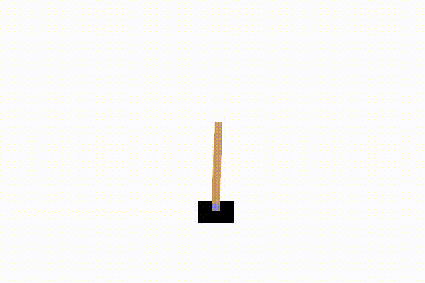

# Bot on Atari games

<table>
  <tr>
    <td align="center">
      <b>DQN on CartPole</b>
    </td>
    <td align="center">
      <b>SAC on Pendulum</b>
    </td>
  </tr>

  <tr>
    <td align="center">
      <a href="./docs/trainings/dql_on_cartpole/dql_on_cartpole.md">
        
      </a>
      <br>
      <a href="./docs/trainings/dql_on_cartpole/dql_on_cartpole.md">
        View training details
      </a>
    </td>
    <td align="center">
      <a href="./docs/trainings/sac_on_pendulum/sac_on_pendulum.md">
        
      </a>
      <br>
      <a href="./docs/trainings/sac_on_pendulum/sac_on_pendulum.md">
        View training details
      </a>
    </td>
  </tr>
</table>

```
python main.py --config configs/dqn_on_cartpole.yaml
python main.py --config configs/sac_on_pendulum.yaml
python main.py --config configs/sac_on_bipedalwalker.yaml
```
```
python main.py --checkpoint runs\CartPole-v1\run_5567\checkpoints\best.pt --episodes 1500
python main.py --checkpoint runs\Pendulum-v1\run_4621\checkpoints\best.pt --episodes 150
```