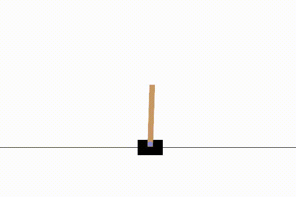
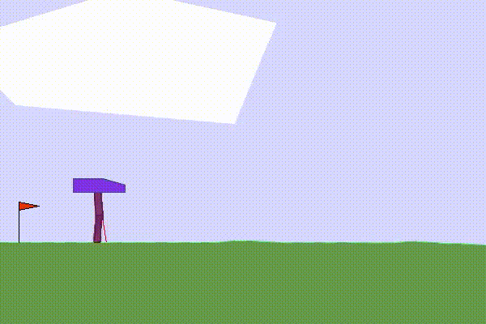
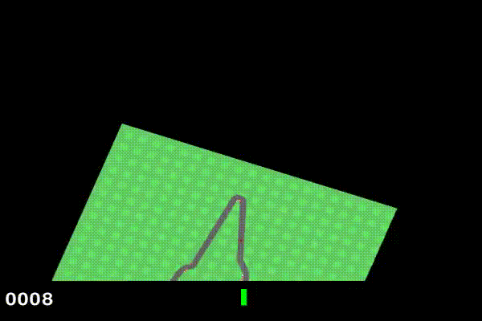

# Deep Reinforcement Learning — DQN & SAC

**PyTorch** implementations of DQN and Soft Actor-Critic for learning to balance, walk, and drive in four **Gymnasium** environments. The experiments share a training loop, YAML configurations, **Weights & Biases** tracking, and model checkpoints.

## Results in action

<table>
  <tr>
    <th align="center">CartPole · DQN</th>
    <th align="center">Pendulum · SAC</th>
  </tr>
  <tr>
    <td align="center">
      <a href="docs/trainings/dql_on_cartpole/dql_on_cartpole.md"></a><br>
      <a href="docs/trainings/dql_on_cartpole/dql_on_cartpole.md">Results, charts, and hyperparameters</a>
    </td>
    <td align="center">
      <a href="docs/trainings/sac_on_pendulum/sac_on_pendulum.md"></a><br>
      <a href="docs/trainings/sac_on_pendulum/sac_on_pendulum.md">Results, charts, and hyperparameters</a>
    </td>
  </tr>
  <tr>
    <th align="center">BipedalWalker · SAC</th>
    <th align="center">CarRacing · SAC + CNN</th>
  </tr>
  <tr>
    <td align="center">
      <a href="docs/trainings/sac_on_bipedalwalker/sac_on_bipedalwalker.md"></a><br>
      <a href="docs/trainings/sac_on_bipedalwalker/sac_on_bipedalwalker.md">Results, charts, and hyperparameters</a>
    </td>
    <td align="center">
      <a href="docs/trainings/sac_on_carracing/sac_on_carracing.md"></a><br>
      <a href="docs/trainings/sac_on_carracing/sac_on_carracing.md">Results, charts, and hyperparameters</a>
    </td>
  </tr>
</table>

| Environment | Agent | Latest mean evaluation reward¹ | Expected runtime² |
| :--- | :--- | ---: | :--- |
| `CartPole-v1` | DQN · fully connected network | 500.00 | A few minutes, roughly 2–5 min |
| `Pendulum-v1` | SAC · fully connected networks | −148.81 | About 2 min |
| `BipedalWalker-v3` | SAC · fully connected networks | 334.42 | About 10 h |
| `CarRacing-v3` | SAC · convolutional encoders | 311.47 | About a day, 29 h for the recorded run |

¹ Values from local W&B summaries, archived in the [reference results](docs/trainings/README.md). Reward scales differ across environments. The historical GIFs and charts cannot all be reliably linked to these same runs.

² Rough estimates on a **4 GB NVIDIA GeForce GTX 1650**, running Windows and Python 3.13. They describe the available runs, which did not necessarily use the full configured episode budget. Hardware, settings, evaluations, and recordings affect runtime. Each experiment page lists the measurements found.

[Setup](#setup) · [Run training](#run-training) · [Configure an experiment](#configure-an-experiment) · [Documentation](#documentation)

## Setup

Prerequisites: **Python 3.13** to match the original working environment, **Git**, and a running **Docker Desktop** instance for the local W&B server. A CUDA-compatible NVIDIA GPU is useful for the two longer experiments; the code uses the CPU if CUDA is unavailable.

From PowerShell:

```powershell
git clone https://github.com/victrolles/RL-on-atari-games.git
cd RL-on-atari-games
python -m venv .venv
.\.venv\Scripts\Activate.ps1
python -m pip install --upgrade pip
python -m pip install -r requirements.txt
```

The requirements file adds the PyTorch **CUDA 13.2** index. To adapt the installation to your hardware, troubleshoot Box2D, or configure Jupyter, see the [detailed setup guide](docs/setup.md).

Then start the **local Weights & Biases** server and connect the client:

```powershell
wandb server start
$env:WANDB_BASE_URL = "http://localhost:8080"
wandb login --host=http://localhost:8080
```

Open [localhost:8080](http://localhost:8080), complete the initial server setup, and sign in using the local account's API key. Experiments will appear in the **`atari-rl`** project. See the [official W&B Server quickstart](https://github.com/wandb/server#quickstart), including local license activation.

To work without a server, see offline mode in the [setup guide](docs/setup.md#offline-mode).

## Run training

Run **one of the following commands** from the repository root, with the virtual environment activated and W&B configured:

```powershell
# CartPole: DQN, a few minutes
python main.py --config configs/dqn_on_cartpole.yaml

# Pendulum: SAC, about 2 minutes
python main.py --config configs/sac_on_pendulum.yaml

# BipedalWalker: SAC, about 10 hours
python main.py --config configs/sac_on_bipedalwalker.yaml

# CarRacing: SAC with CNNs, about a day
python main.py --config configs/sac_on_carracing.yaml
```

Always provide `--config` for a new training run: the default path in `main.py`, `configs/sac.yaml`, does not exist in the repository.

### Adjust the episode count

```powershell
python main.py --config configs/sac_on_pendulum.yaml --episodes 80
```

`--episodes` sets the **target total number of episodes**. A very short run may end before the first evaluation or before updates begin; in that case, it will not produce a checkpoint.

### Resume training

Replace `run_XXXX` with the directory shown at startup:

```powershell
python main.py --checkpoint runs/Pendulum-v1/run_XXXX/checkpoints/latest.pt --episodes 80
```

Use `best.pt` to resume from the best evaluated checkpoint. Resuming reloads the experiment's `config.yaml`: **do not combine `--checkpoint` and `--config`**. It restores the networks, optimizers, and progress, but starts with an empty replay buffer. It also creates a new W&B session.

## Configure an experiment

**To change training settings, edit the corresponding `.yaml` file in [`configs/`](configs/).** Omitted fields use the defaults from [`configs/config.py`](configs/config.py).

| Section | Useful parameters | Purpose |
| :--- | :--- | :--- |
| `env` | `name`, `device`, `normalize` | Environment, CPU/CUDA, and action rescaling |
| `network` | `hidden_size` | Width of fully connected layers |
| `training` | `nb_episodes`, `learning_starts`, `random_steps` | Budget, learning start, and initial exploration |
| `training` | `train_freq`, `gradient_steps`, `evaluation_interval` | Update and evaluation frequency |
| `replay` | `capacity`, `batch_size` | Replay buffer and batch sizes |
| `agent` | Learning rates, `gamma`, DQN or SAC parameters | Algorithm settings |
| `logging` | `run_dir` | Parent directory for experiments |

For example, in the Pendulum configuration:

```yaml
training:
  nb_episodes: 80
  evaluation_interval: 10
```

This snippet shows which fields to edit in the existing file. Evaluations currently use **20 deterministic episodes**, followed by **3 recorded episodes**; these counts are defined in [`trainer.py`](trainer.py). The experiment pages detail all hyperparameters and the few settings that remain fixed in the code.

### Locate the outputs

```text
runs/<environment>/run_XXXX/
├── config.yaml         # Configuration copied when the experiment is created
├── checkpoints/
│   ├── latest.pt       # Latest saved evaluation
│   └── best.pt         # Best saved mean evaluation reward
├── models/             # Weights and metadata exported at evaluations
├── records/            # MP4 videos of recorded episodes
└── wandb/              # Local W&B logs
```

Checkpoints and videos are produced every `evaluation_interval` episodes, with no guaranteed extra final save between evaluations. `runs/` is ignored by Git; media intended for the documentation is kept in `docs/trainings/`.

The configuration file is copied **before** `--episodes` is applied: when overriding it on the command line, also keep the command used. The `inference.py` script is still a draft; usable evaluations and videos currently run through the training workflow.

## Project structure

```text
agents/          # DQN and SAC agents, fully connected and convolutional networks
configs/         # YAML configurations and typed loading
docs/            # Setup, results, and technical notes
models/          # Selected weights kept in the repository
tests/           # Exploration and verification scripts and notebooks
env.py           # Environments, preprocessing, and video recording
main.py          # Entry point and experiment resumption
replay_buffer.py # Shared replay buffer
trainer.py       # Training, evaluation, metrics, and checkpoints
```

## Documentation

- [Detailed setup, W&B, CUDA, and Jupyter](docs/setup.md)
- [Reference results and interpretation guidelines](docs/trainings/README.md)
- [CartPole — DQN](docs/trainings/dql_on_cartpole/dql_on_cartpole.md)
- [Pendulum — SAC](docs/trainings/sac_on_pendulum/sac_on_pendulum.md)
- [BipedalWalker — SAC](docs/trainings/sac_on_bipedalwalker/sac_on_bipedalwalker.md)
- [CarRacing — SAC with CNNs](docs/trainings/sac_on_carracing/sac_on_carracing.md)
- [Technical note: learning rate scheduler](docs/technologies/lr_scheduler.md)

Despite the repository's historical name, these four experiments use Gymnasium's **Classic Control** and **Box2D** environments.
