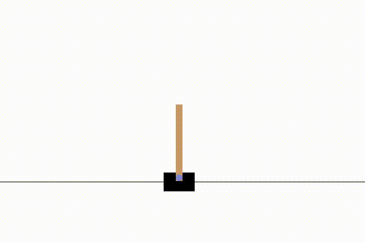
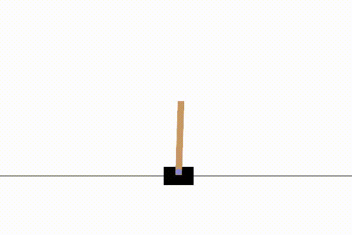

# CartPole — DQN

[← README](../../../README.md) · [Résultats et protocole](../README.md) · [Installation](../../setup.md)

Maintenir un pendule vertical en déplaçant son chariot vers la gauche ou la droite. Cette tâche à actions discrètes sert de première expérience pour le DQN. L'environnement fournit quatre observations et deux actions possibles ; un épisode de `CartPole-v1` est limité à 500 pas dans sa configuration standard. [Description Gymnasium](https://gymnasium.farama.org/environments/classic_control/cart_pole/).

## Avant / après

<table>
  <tr><th align="center">Enregistrement initial</th><th align="center">Après entraînement</th></tr>
  <tr>
    <td align="center"></td>
    <td align="center"></td>
  </tr>
</table>

## Résultats et durée

| Indicateur | Valeur |
| :--- | :--- |
| Temps à prévoir | Quelques minutes, environ 2 à 5 min sur la machine de référence |
| Durée notée dans la documentation historique | 2 min 39 s |
| Durée du résumé W&B local | 4 min 27 s |
| Dernière moyenne d'évaluation du résumé local | 500,00 |
| Interactions cumulées du résumé local | 305 540 |
| Essai local | `run_7834` · W&B `gfulc9v8` |
| Matériel de référence | NVIDIA GeForce GTX 1650 · 4 Go |

La dernière moyenne relevée atteint le plafond de durée de l'environnement. Elle décrit cette évaluation précise et ne mesure pas la stabilité entre plusieurs entraînements. Les durées historiques et locales proviennent de relevés différents ; les [sources archivées](../results.json) et le [protocole de lecture](../README.md) précisent cette distinction.

## Méthode et technologies

- **PyTorch** : réseau dense à deux couches cachées et activations ReLU pour estimer les Q-valeurs.
- **DQN** : apprentissage sur un replay buffer et exploration **epsilon-greedy** après la phase initiale d'actions aléatoires.
- **Adam** et **MSE** : optimisation de l'écart entre la Q-valeur choisie et sa cible de différence temporelle.
- **CosineAnnealingWarmRestarts** : variation cyclique du taux d'apprentissage ; voir la [note technique](../../technologies/lr_scheduler.md).
- **Gymnasium**, **W&B** et **RecordVideo** : simulation, suivi des métriques et enregistrement des évaluations.

Dans cette implémentation, les cibles DQN sont calculées avec le même réseau que les Q-valeurs courantes ; il n'y a pas de réseau cible distinct. Le [schéma de réseau historique](architecture_model.png) reste disponible à titre illustratif.

## Courbes et analyse

### Récompenses

<table>
  <tr><th align="center">Récompense d'entraînement</th><th align="center">Récompense d'évaluation</th></tr>
  <tr><td align="center"></td><td align="center"></td></tr>
</table>

La récompense d'entraînement augmente progressivement, d'une vingtaine à environ 260 sur l'export. L'évaluation progresse également, avec plusieurs reculs intermédiaires, avant d'atteindre 500 au dernier point. L'écart entre les deux courbes est compatible avec une politique encore exploratoire pendant l'entraînement et une sélection déterministe en évaluation. Il ne permet pas, à lui seul, de mesurer la variance de l'agent.

### Exploration et erreur de valeur

<table>
  <tr><th align="center">Exploration epsilon-greedy</th><th align="center">Perte MSE du réseau Q</th></tr>
  <tr><td align="center"></td><td align="center"></td></tr>
</table>

L'epsilon décroît régulièrement d'environ 1 à 0,3 : le minimum de 0,01 n'est pas atteint sur la portion exportée. L'agent continue donc à essayer des actions aléatoires pendant une part importante de l'entraînement.

La perte présente une forte phase d'instabilité, avec des pics de l'ordre de `5 × 10⁸`, puis revient à une échelle beaucoup plus faible. La progression des récompenses indique un apprentissage utile sur cet essai, mais ces pics justifient de surveiller les estimations de valeur et de comparer plusieurs exécutions. L'export seul ne permet pas d'attribuer cette instabilité à un hyperparamètre précis.

Ces figures sont historiques ; l'axe `Step` ne doit pas être interprété automatiquement comme un nombre d'épisodes. La courbe epsilon n'est plus journalisée par l'agent DQN actuel.

## Reproduire l'expérience

Depuis la racine du dépôt, après le [setup](../../setup.md) :

```powershell
python main.py --config configs/dqn_on_cartpole.yaml
```

## Hyperparamètres

Valeurs de la [configuration actuelle](../../../configs/dqn_on_cartpole.yaml), complétées par les défauts de [`configs/config.py`](../../../configs/config.py). Elles décrivent le lancement proposé, sans garantir les réglages des courbes historiques.

### Environnement et réseau

| Paramètre | Valeur |
| :--- | :--- |
| `env.name` | `CartPole-v1` |
| `env.device` | `cuda` |
| `env.normalize` | `false` |
| `network.hidden_size` | `64` |

### Entraînement et replay buffer

| Paramètre | Valeur |
| :--- | :--- |
| `training.nb_episodes` | `10000` |
| `training.learning_starts` | `10000` |
| `training.random_steps` | `10000` |
| `training.train_freq` | `40` |
| `training.gradient_steps` | `2` |
| `training.evaluation_interval` | `100` |
| `replay.capacity` | `1000` |
| `replay.batch_size` | `64` |

`learning_starts`, `random_steps` et `train_freq` sont exprimés en interactions avec l'environnement. `gradient_steps` est le nombre de mises à jour par déclenchement ; `evaluation_interval` est exprimé en épisodes.

### Optimisation

| Paramètre | Valeur |
| :--- | :--- |
| `agent.learning_rate` | `0.01` |
| `agent.gamma` | `0.99` |
| `agent.epsilon` | `1.0` |
| `agent.epsilon_decay` | `0.999` |
| `agent.epsilon_min` | `0.01` |

L'epsilon est multiplié par `epsilon_decay` à chaque mise à jour de l'agent, jusqu'à `epsilon_min`. Le scheduler utilise `T_0=50`, `T_mult=1` et `eta_min=0` ; il avance à chaque mise à jour. Ces réglages du scheduler restent définis dans le code.

Le suivi utilise le projet W&B `atari-rl` et crée les sorties sous `runs/` par défaut. Les évaluations comprennent **20 épisodes déterministes**, puis **3 épisodes enregistrés**, selon le [protocole commun](../README.md#protocole-du-code-actuel).
