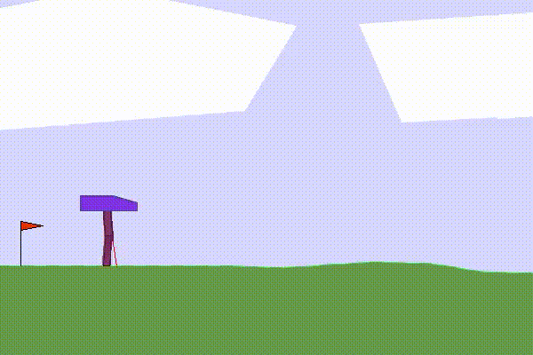
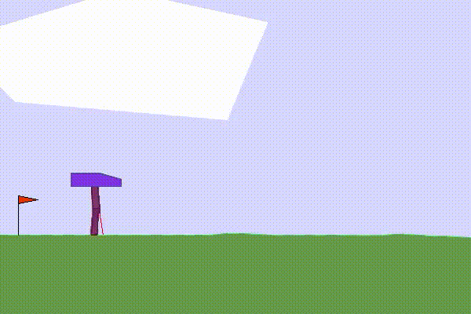

# BipedalWalker — Soft Actor-Critic

[← README](../../../README.md) · [Résultats et protocole](../README.md) · [Installation](../../setup.md)

Faire avancer un robot bipède sur un terrain irrégulier en contrôlant ses quatre articulations. L'environnement fournit 24 observations et quatre actions continues dans `[-1, 1]`. Le projet utilise la variante standard de `BipedalWalker-v3`, sans activer le mode hardcore. [Description Gymnasium](https://gymnasium.farama.org/environments/box2d/bipedal_walker/).

## Avant / après

<table>
  <tr><th align="center">Enregistrement initial</th><th align="center">Après entraînement</th></tr>
  <tr>
    <td align="center"></td>
    <td align="center"></td>
  </tr>
</table>

## Résultats et durée

| Indicateur | Valeur |
| :--- | :--- |
| Temps à prévoir | Environ 10 h sur la machine de référence |
| Premiers résultats prometteurs, selon les notes historiques | Environ 1 h |
| Durée notée dans la documentation historique | 9 h 30 |
| Durée du résumé W&B local | 9 h 33 min 52 s |
| Dernière moyenne d'évaluation du résumé local | 334,42 |
| Interactions cumulées du résumé local | 1 197 187 |
| Essai local | `run_3025` · W&B `yqzyzht5` |
| Matériel de référence | NVIDIA GeForce GTX 1650 · 4 Go |

La dernière évaluation locale obtient une récompense élevée, mais les exports révèlent aussi des rechutes importantes pendant l'apprentissage. Les dix heures sont un repère de planification pour l'essai réalisé, pas une garantie de durée pour l'intégralité des 5 000 épisodes configurés. Les [sources archivées](../results.json) permettent de retrouver les valeurs exactes.

## Méthode et technologies

- **SAC** : un acteur gaussien, deux critiques et leurs réseaux cibles, avec replay buffer.
- **PyTorch** : réseaux denses à deux couches cachées de 512 unités et activations ReLU.
- **Adam** : optimisation de l'acteur, de chaque critique et de la température d'entropie `alpha`.
- **MSE** pour les critiques ; objectif SAC régularisé par l'entropie pour l'acteur, avec température apprise et entropie cible `−4`.
- **Gymnasium / Box2D**, **W&B** et **RecordVideo** : simulation physique, suivi et enregistrement.

Les actions de la politique sont bornées par `tanh` dans l'intervalle attendu par l'environnement ; aucune remise à l'échelle supplémentaire n'est activée. Les mises à jour sont regroupées : après la phase initiale, le code effectue 64 mises à jour toutes les 64 interactions. Aucun scheduler de taux d'apprentissage n'est utilisé pour SAC.

## Courbes et analyse

### Récompenses

<table>
  <tr><th align="center">Récompense d'entraînement</th><th align="center">Récompense d'évaluation</th></tr>
  <tr><td align="center"></td><td align="center"></td></tr>
</table>

Les récompenses d'entraînement passent d'une zone négative à un plateau fréquent autour de 330. Des épisodes très faibles persistent pourtant tout au long de l'export. L'agent acquiert donc un comportement efficace sur de nombreux épisodes, avec des échecs occasionnels encore marqués.

L'évaluation confirme cette lecture : plusieurs plateaux au-dessus de 300 alternent avec des chutes proches de −100. La qualité des meilleurs passages ne suffit pas à établir une stabilité continue. Les graphiques seuls ne permettent pas de séparer les effets de la politique, des terrains rencontrés et des mises à jour successives.

### Objectifs d'optimisation

<table>
  <tr><th align="center">Perte de l'acteur</th><th align="center">Perte du critique · export 1</th></tr>
  <tr><td align="center"></td><td align="center"></td></tr>
  <tr><th align="center">Perte du critique · export 2</th></tr>
  <tr><td align="center"></td></tr>
</table>

La perte de l'acteur se stabilise globalement à une valeur négative après la phase initiale. Les deux exports de perte critique restent généralement proches du bas de l'échelle affichée, avec un pic net vers l'abscisse `1,1M`. L'acteur présente aussi une perturbation dans cette zone, suivie d'un retour vers son niveau précédent.

Ces événements sont compatibles avec un ajustement transitoire des estimations de valeur ; leur cause n'est pas identifiable avec ces seules courbes. Les noms des deux exports critiques ne précisent pas lequel correspond à `critic_1_loss` ou `critic_2_loss` ; les figures restent donc nommées par numéro d'export.

### Température d'entropie

<table>
  <tr><th align="center">Coefficient d'entropie alpha</th><th align="center">Perte de la température d'entropie</th></tr>
  <tr><td align="center"></td><td align="center"></td></tr>
</table>

Le coefficient `alpha` diminue rapidement depuis sa valeur initiale de 0,2, puis reste proche de 0,01 avec quelques pointes. Le résumé local relève `alpha ≈ 0,0106`. Le poids du terme d'entropie devient donc plus faible, tout en continuant à s'adapter. La perte associée oscille autour d'une zone relativement stable après le début de l'apprentissage ; cela ne garantit pas l'absence d'échecs du robot.

### Mémoire et progression

<table>
  <tr><th align="center">Taille du replay buffer</th><th align="center">Interactions cumulées : Steps total</th></tr>
  <tr><td align="center"></td><td align="center"></td></tr>
</table>

Le buffer atteint sa capacité de 300 000 transitions puis reste constant : les nouvelles expériences remplacent les plus anciennes. Ce plateau décrit le stockage, pas un arrêt de l'apprentissage. `Steps total` continue à croître sur toute la portion exportée.

L'axe horizontal `Step` est conservé tel qu'exporté par W&B. La figure de progression et le résumé local couvrent des étendues différentes ; leurs dernières valeurs ne sont pas assimilées.

## Reproduire l'expérience

Depuis la racine du dépôt, après le [setup](../../setup.md) :

```powershell
python main.py --config configs/sac_on_bipedalwalker.yaml
```

Prévoir une exécution longue et conserver `checkpoints/best.pt` pour retrouver la meilleure évaluation sauvegardée, même si les suivantes régressent. La [commande de reprise](../../../README.md#reprendre-un-entraînement) permet de prolonger un essai.

## Hyperparamètres

Valeurs de la [configuration actuelle](../../../configs/sac_on_bipedalwalker.yaml), complétées par les défauts de [`configs/config.py`](../../../configs/config.py). Elles décrivent le lancement proposé, sans garantir les réglages des courbes historiques.

### Environnement et réseau

| Paramètre | Valeur |
| :--- | :--- |
| `env.name` | `BipedalWalker-v3` |
| `env.device` | `cuda` |
| `env.normalize` | `false` |
| `network.hidden_size` | `512` |

### Entraînement et replay buffer

| Paramètre | Valeur |
| :--- | :--- |
| `training.nb_episodes` | `5000` |
| `training.learning_starts` | `10000` |
| `training.random_steps` | `10000` |
| `training.train_freq` | `64` |
| `training.gradient_steps` | `64` |
| `training.evaluation_interval` | `30` |
| `replay.capacity` | `300000` |
| `replay.batch_size` | `256` |

`learning_starts`, `random_steps` et `train_freq` sont exprimés en interactions avec l'environnement. `gradient_steps` est le nombre de mises à jour par déclenchement ; `evaluation_interval` est exprimé en épisodes.

### Optimisation

| Paramètre | Valeur |
| :--- | :--- |
| `agent.actor_lr` | `0.00073` |
| `agent.critic_lr` | `0.00073` |
| `agent.alpha_lr` | `0.00073` |
| `agent.gamma` | `0.98` |
| `agent.tau` | `0.02` |
| `agent.alpha` | `0.2` |

`alpha` est la valeur initiale du coefficient d'entropie, ensuite appris automatiquement. Les bornes `log_std` configurées sont `-20` et `2`, mais le constructeur utilise actuellement les bornes effectives **−5 et 2** : ces deux champs YAML ne lui sont pas transmis.

Le suivi utilise le projet W&B `atari-rl` et crée les sorties sous `runs/` par défaut. Les évaluations comprennent **20 épisodes déterministes**, puis **3 épisodes enregistrés**, selon le [protocole commun](../README.md#protocole-du-code-actuel).
