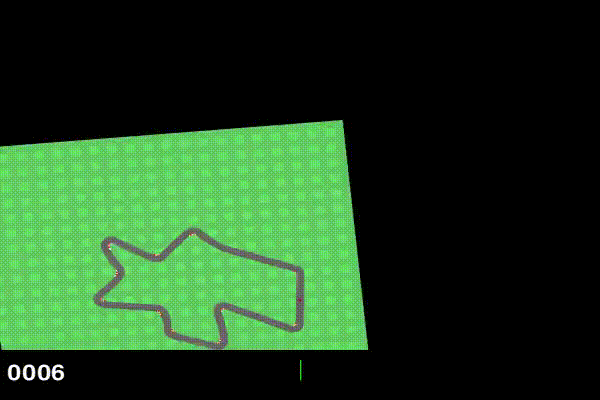
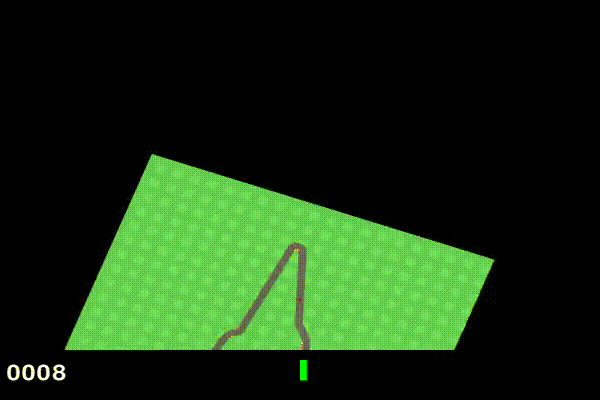

# CarRacing — Soft Actor-Critic avec CNN

[← README](../../../README.md) · [Résultats et protocole](../README.md) · [Installation](../../setup.md)

Apprendre à conduire à partir des images du circuit en contrôlant la direction, l'accélération et le freinage. `CarRacing-v3` fournit des images RGB de `96 × 96` pixels et utilise ici son espace d'actions continu. Les circuits sont générés à chaque réinitialisation. [Description Gymnasium](https://gymnasium.farama.org/environments/box2d/car_racing/).

## Avant / après

<table>
  <tr><th align="center">Enregistrement initial</th><th align="center">Après entraînement</th></tr>
  <tr>
    <td align="center"></td>
    <td align="center"></td>
  </tr>
</table>

## Résultats et durée

| Indicateur | Valeur |
| :--- | :--- |
| Temps à prévoir | Environ une journée ; prévoir jusqu'à 30 h sur la machine de référence |
| Estimation issue du retour d'expérience | Une journée |
| Durée du résumé W&B local | 29 h 18 min 44 s |
| Dernière moyenne d'évaluation du résumé local | 311,47 |
| Interactions cumulées du résumé local | 999 443 |
| Essai local | `run_8544` · W&B `w5q1kcxw` |
| Matériel de référence | NVIDIA GeForce GTX 1650 · 4 Go |

Cette expérience est la plus longue des quatre : l'agent apprend à la fois une représentation visuelle et une politique de contrôle. La dernière moyenne d'évaluation locale reste inférieure à certains pics des courbes ; elle ne représente donc pas le meilleur résultat atteint. Les [sources archivées](../results.json) conservent les métriques exactes.

## Méthode et technologies

- **SAC** : acteur gaussien, deux critiques, deux critiques cibles et replay buffer.
- **CNN PyTorch** : encodeurs convolutifs dans l'acteur et les critiques pour traiter les images.
- **Adam** : optimisation des réseaux et de la température d'entropie `alpha`.
- **MSE** pour les critiques ; objectif SAC régularisé par l'entropie pour l'acteur, avec température apprise et entropie cible `−3`.
- **Gymnasium / Box2D**, **W&B** et **RecordVideo** : simulation, courbes et vidéos.

### Prétraitement visuel et actions

Les trois environnements utilisés pour l'entraînement, l'évaluation et la vidéo appliquent les mêmes transformations dans [`env.py`](../../../env.py) :

1. Conversion en niveaux de gris.
2. Redimensionnement à `84 × 84` pixels.
3. Empilement de **4 images**, soit une observation de forme `(4, 84, 84)`.
4. Conversion des pixels de `[0, 255]` vers `[0, 1]` dans l'encodeur CNN.

`RescaleAction` convertit les sorties de la politique dans `[-1, 1]` vers les bornes natives de la direction, de l'accélérateur et du frein. Aucun saut d'images ni augmentation d'images n'est appliqué dans l'implémentation actuelle. Aucun scheduler de taux d'apprentissage n'est utilisé pour SAC.

## Courbes et analyse

### Récompenses

<table>
  <tr><th align="center">Récompense d'entraînement</th><th align="center">Récompense d'évaluation</th></tr>
  <tr><td align="center"></td><td align="center"></td></tr>
</table>

La récompense d'entraînement quitte une zone initialement négative et atteint régulièrement des scores élevés, parfois proches de 900. La dispersion demeure importante : de nombreux épisodes restent faibles, même tard dans l'export. Les bons épisodes isolés ne démontrent donc pas une conduite fiable sur tous les circuits.

L'évaluation s'améliore d'abord nettement, puis oscille généralement entre environ 200 et 500, avec un pic proche de 600 et plusieurs reculs. La dernière moyenne locale de 311,47 est cohérente avec un apprentissage encore irrégulier. La variété des pistes et l'évolution de la politique peuvent contribuer à cette dispersion ; les exports ne permettent pas de quantifier leurs effets respectifs.

### Pertes de l'acteur et du critique

<table>
  <tr><th align="center">Perte de l'acteur</th><th align="center">Perte du critique exportée</th></tr>
  <tr><td align="center"></td><td align="center"></td></tr>
</table>

La perte de l'acteur commence par augmenter, puis devient négative et fluctue autour d'un nouveau niveau. Son signe et son amplitude dépendent des Q-valeurs et de l'entropie ; ils ne s'interprètent pas comme une erreur de conduite. La perte critique demeure majoritairement dans la partie basse de l'échelle affichée, avec des pics ponctuels, alors que les récompenses restent dispersées.

L'export de l'acteur couvre une plage d'abscisses plus courte que les trois autres figures. Sans identification complète de leurs sessions et de leurs réglages d'axe, on ne peut pas aligner précisément les événements entre ces graphiques. L'axe `Step` est conservé dans sa forme d'origine.

## Reproduire l'expérience

Depuis la racine du dépôt, après le [setup](../../setup.md) :

```powershell
python main.py --config configs/sac_on_carracing.yaml
```

Prévoir suffisamment de RAM pour le replay buffer d'images et d'espace disque pour les modèles et les vidéos. Une réduction de `replay.capacity` ou de `replay.batch_size` peut rendre un nouvel essai plus accessible, en modifiant ses conditions d'apprentissage. Conserver les configurations comparées.

## Hyperparamètres

Valeurs de la [configuration actuelle](../../../configs/sac_on_carracing.yaml), complétées par les défauts de [`configs/config.py`](../../../configs/config.py). Elles décrivent le lancement proposé, sans garantir les réglages des courbes historiques.

### Environnement et réseau

| Paramètre | Valeur |
| :--- | :--- |
| `env.name` | `CarRacing-v3` |
| `env.device` | `cuda` |
| `env.normalize` | `true` |
| `network.hidden_size` | `256` |

### Entraînement et replay buffer

| Paramètre | Valeur |
| :--- | :--- |
| `training.nb_episodes` | `1000` |
| `training.learning_starts` | `10000` |
| `training.random_steps` | `10000` |
| `training.train_freq` | `1` |
| `training.gradient_steps` | `1` |
| `training.evaluation_interval` | `25` |
| `replay.capacity` | `50000` |
| `replay.batch_size` | `128` |

`learning_starts`, `random_steps` et `train_freq` sont exprimés en interactions avec l'environnement. `gradient_steps` est le nombre de mises à jour par déclenchement ; `evaluation_interval` est exprimé en épisodes.

### Optimisation

| Paramètre | Valeur |
| :--- | :--- |
| `agent.actor_lr` | `0.0003` |
| `agent.critic_lr` | `0.0003` |
| `agent.alpha_lr` | `0.0003` |
| `agent.gamma` | `0.99` |
| `agent.tau` | `0.005` |
| `agent.alpha` | `0.2` |

`alpha` est la valeur initiale du coefficient d'entropie, ensuite appris automatiquement. Les bornes `log_std` configurées sont `-20` et `2`, mais le constructeur utilise actuellement les bornes effectives **−5 et 2** : ces deux champs YAML ne lui sont pas transmis.

Le suivi utilise le projet W&B `atari-rl` et crée les sorties sous `runs/` par défaut. Les évaluations comprennent **20 épisodes déterministes**, puis **3 épisodes enregistrés**, selon le [protocole commun](../README.md#protocole-du-code-actuel).

## Pistes d'amélioration

- Évaluer sur davantage de circuits et plusieurs graines, en conservant la dispersion des scores.
- Journaliser vitesse, direction, accélération, freinage et longueur d'épisode pour mieux expliquer les échecs.
- Expérimenter un saut d'images avec accumulation des récompenses, en respectant les fins d'épisode.
- Comparer un stockage de replay plus efficace et des augmentations visuelles comme les décalages ou recadrages aléatoires.

Ces pistes prolongent les notes de l'expérience ; elles ne sont pas implémentées dans le dépôt.
